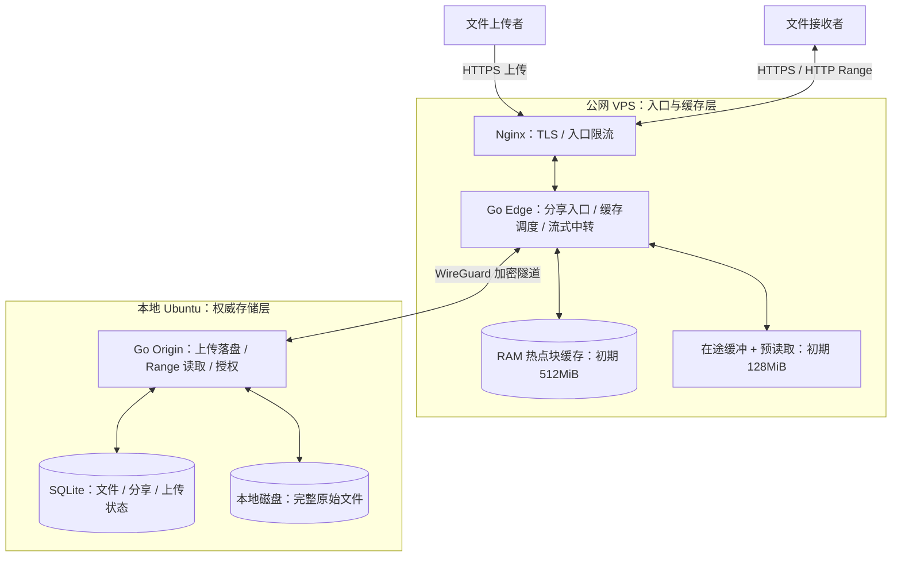
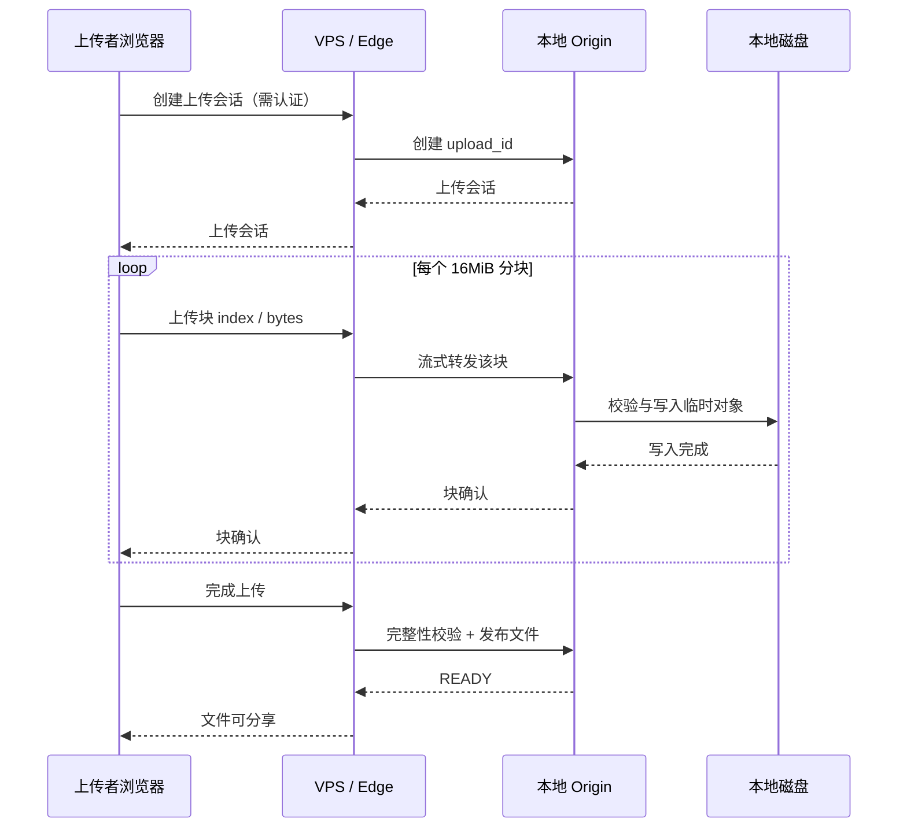
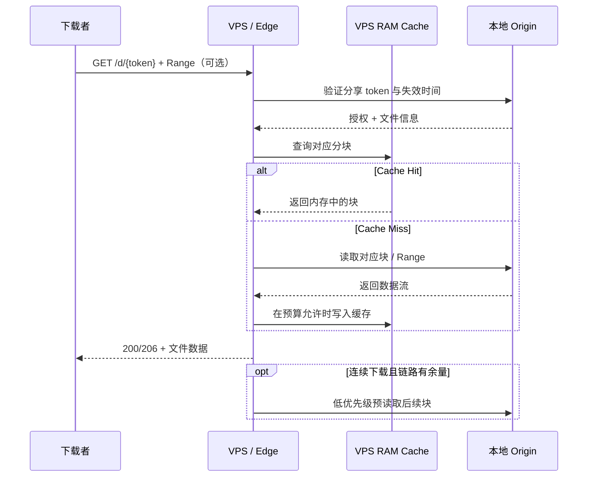

# 临时大文件分享系统：项目框架与技术设计（v1.0）

> **项目定位**：自建的临时大文件分享服务。原始文件存储在本地 Ubuntu 服务器，VPS 作为唯一公网入口和全部上传/下载流量的中转节点。VPS 使用受控 RAM 缓存，结合流式转发（A）与热点分块缓存（B），让用户只需打开一个有期限的链接即可下载 1–5GB 文件。
>
> **文档日期**：2026-11-18  
> **文档状态**：架构讨论稿，可作为 MVP 开发依据；部分参数是建议值，尚需网络测试验证。  
> **本文依据**：截至目前的项目讨论与 VPS `htop`、`free -h`、`vmstat 1 5` 实测输出。未把尚未测试的网络性能当作既定事实。

---

## 1. 项目概述

### 1.1 项目背景

需要向其他人远程分发 1–5GB 的大型文件。发送者只要上传文件、生成一个分享链接并指定有效期；接收者无需安装客户端，打开链接即可下载。项目应优先利用现有的本地服务器与 VPS，不希望把完整文件长期存储在 VPS 上。

### 1.2 核心设想：VPS 像内存，本地服务器像硬盘

- **本地 Ubuntu 服务器：持久化存储（Origin）**。保存文件的完整原始副本，负责上传落盘、文件校验、元数据、分享授权与生命周期管理。
- **VPS：高速缓存与公网入口（Edge）**。处理 HTTPS 请求，将上传与下载流量全部中转，并利用有限的 RAM 缓存近期或即将使用的文件分块。
- **接收者：浏览器或下载工具（Client）**。使用普通 HTTPS 与 HTTP Range 访问文件，可断点续传。
- **通信隧道：WireGuard**。在 VPS 与本地服务器之间建立专用加密通路；本地服务无需直接暴露到公网。

这属于一个小型的 **分层存储 + 边缘缓存 + 流式文件分发系统**，不是传统意义上把文件整体搬运到 VPS 的网盘。

### 1.3 主要目标

1. 处理单文件约 1–5GB 的上传与下载。
2. 生成不可预测、可设置期限的分享链接；接收者无需登录即可下载。
3. 支持上传断点续传和下载断点续传。
4. 所有外部文件流量经过 VPS，原始文件仅持久存储在本地服务器。
5. VPS 以**总预算**限制缓存与预读取的内存使用量，缓存满后自动淘汰。
6. 对相同文件的重复下载复用缓存，并对连续下载适度预读取。
7. 能够监控吞吐量、内存、缓存命中率和失败原因，便于后续调优。

### 1.4 MVP 不包含的内容

- 多用户商业化账号体系、付费、复杂权限团队协作。
- 端到端加密（E2EE）、内容在线预览、实时协同编辑。
- 全球多节点 CDN、完整 P2P 传输、跨 VPS 自动容灾。
- “保证整份 5GB 文件持续以 VPS 公网口速率下载”：物理链路无法做此保证。

---

## 2. 已确认的需求与待确认事项

### 2.1 已确认的需求

| 编号 | 需求 | 确认程度 |
|---|---|---|
| R-01 | 分发 1–5GB 大文件 | 已确认 |
| R-02 | 用户只需分享链接，接收者可直接下载 | 已确认 |
| R-03 | 链接具有可配置的有效期 | 已确认 |
| R-04 | 本地服务器才是原始文件的持久存储位置 | 已确认 |
| R-05 | VPS 必须中转**全部**公网上传与下载流量 | 已确认 |
| R-06 | VPS 兼顾 A：流式缓冲 / 预读取，以及 B：复用热点缓存 | 已确认 |
| R-07 | VPS 希望提供约 1GB 的缓冲能力 | 目标已确认，实际安全配置需测试 |
| R-08 | VPS 当前物理内存约 3.8GiB | 已通过命令确认 |

### 2.2 项目方案中的建议（尚非用户逐项确认）

| 项目 | 当前建议 | 为什么 |
|---|---|---|
| 后端语言 | Go | 适合流式 I/O、并发、缓存调度，单进程资源相对可控 |
| VPS Web 入口 | Nginx | HTTPS、限流和反向代理 |
| 前端 | React + Vite 构建静态页面 | 不需在小内存 VPS 上运行常驻 Next.js 服务 |
| VPS↔本地互联 | WireGuard | 加密、私有地址、避免公开本地服务 |
| 元数据数据库 | 本地服务器 SQLite（MVP） | 简单、易备份，授权以本地为权威 |
| 分块大小 | 16MiB | 平衡请求开销、断点续传和缓存管理 |
| 第一阶段缓存 | 512MiB 热点 + 128MiB 在途/预读取 | 比立刻用满 1GiB 更稳妥 |
| 第二阶段缓存 | 768MiB 热点 + 256MiB 在途/预读取 | 需要经过压测和内存监控 |
| 过期下载策略 | 到期后拒绝新请求；已建立的下载允许完成 | 较易实现、用户体验更好 |

### 2.3 尚未确认的关键问题

1. 本地服务器与 VPS 分别位于哪个国家或地区，是否有公网 IPv4/IPv6，是否处于 NAT 后面？
2. **本地服务器 → VPS 的持续有效上行速率与延迟是多少？**（当前没有数据）
3. VPS → 主要下载者的可用出站速率、流量限制及费用是什么？
4. 预计同时下载的用户数、是否需要公开上传、上传者是否仅为自己？
5. 链接过期时，是否同时**物理删除本地原始文件**，还是仅撤销分享？
6. 需要几种有效期（1 小时 / 24 小时 / 7 天 / 自定义）和可选下载密码吗？
7. 是否需要多分享链接指向同一个文件、文件重复上传去重？

> **特别说明**：不能因 VPS 有 1GB 缓存就推断整份 5GB 文件可实现高速下载。缓存解决短时速率波动、重复请求和部分热点读取，长期吞吐仍由最慢链路决定。

---

## 3. 现有 VPS 资源评估

### 3.1 用户提供的实际数据

来自 RackNerd VPS 的 `free -h`：

```text
               total        used        free      shared  buff/cache   available
Mem:           3.8Gi       2.0Gi       205Mi       2.2Mi       2.0Gi       1.8Gi
Swap:          2.0Gi       1.2Gi       771Mi
```

来自 `vmstat 1 5`：采样期间后四行 `si=0`、`so=0`；未发现**持续**交换活动。`htop` 显示约 3 个逻辑 CPU，CPU 与 load 暂时较低。

### 3.2 结论

- `free` 只有约 205MiB 不是可用内存的真实上限；`available` 约 1.8GiB，部分 page cache 可以回收。
- Swap 已用约 1.2GiB **不等于**现在发生内存抖动；短时间的采样只能说明当时未持续换入换出。
- VPS 上已有其他服务。**不应直接固定占满 1GiB RAM**，应设定缓存硬上限、服务内存上限并做压力测试。
- 内存预算只是设计起点，不能取代并发、吞吐与长时间稳定性测试。

### 3.3 推荐预算

| 项目 | 第一阶段 | 第二阶段（压测通过后） |
|---|---:|---:|
| 可复用分块缓存（B） | 512MiB | 768MiB |
| 在途流式数据与预读取（A） | 128MiB | 256MiB |
| 合计数据预算 | **640MiB** | **1024MiB** |
| 系统与其余服务余量 | 不强行预留为固定占用，持续观察 | 压测时确保不会 OOM / 持续换页 |

> 上述缓存预算不等于整个 Go 进程的 RSS 上限；Go 运行时、连接缓冲、Nginx、内核 socket buffer 等还会占用内存。可以给进程另设上限并按实测适配。默认未使用的预算不应提前分配。

---

## 4. 系统整体架构

### 4.1 逻辑架构图



### 4.2 角色与职责

| 组件 | 责任 | 不负责 |
|---|---|---|
| Nginx（VPS） | TLS、反向代理、请求大小/速率限制 | 不保存完整 5GB 文件，不作为核心数据缓存 |
| Go Edge（VPS） | 校验分享访问、HTTP Range、缓存命中与淘汰、预读取、同块请求合并、流式中转 | 不作为原始文件权威副本 |
| Go Origin（本地） | 文件分块写入、完整性检查、授权权威、Range 读取、删除与元数据 | 不直接向公众开放下载接口 |
| SQLite（本地） | 文件记录、上传任务、分享权限、失效时间 | 不存储二进制大文件 |
| 本地磁盘 | 原始文件、上传临时块、完整文件持久化 | 不依赖 VPS 缓存存活 |
| WireGuard | 提供两机加密的受限私有网络 | 不保证额外带宽、不自动解决网络质量问题 |

### 4.3 重要部署规则

- 公网只开放 VPS 的 80/443（和必要的 WireGuard UDP 端口）；后端管理接口仅授权访问。
- 本地 Origin 只监听 WireGuard 内网 IP；使用防火墙阻断外部直接访问。
- VPS 的下载 API 在**检查分享授权之后**才查询或返回缓存，避免缓存绕过过期限制。
- 文件名仅用于显示与 Content-Disposition，不直接映射为用户可控磁盘路径；磁盘用随机 `object_id`。
- 本地数据是唯一可靠副本：缓存重启丢失不影响文件完整性。

---

## 5. 核心业务流程

### 5.1 上传完整流程

1. 已认证的上传者通过网页创建上传任务，提供文件名、大小和可选 SHA-256。
2. 本地 Origin 创建上传记录与临时存储对象，返回 `upload_id`。
3. 浏览器按 16MiB 分块向 VPS 提交数据；VPS **流式转发**分块到本地服务器。
4. 本地服务器写入临时文件（或分块暂存），校验分块长度/索引，确认持久化成功后才确认该块上传成功。
5. 上传中断后，客户端查询已确认的分块并续传缺失部分，避免从头上传 5GB。
6. 所有块齐全后，Origin 校验总大小（建议校验整文件 SHA-256），原子地标记文件为 `READY`。
7. 创建分享链接及过期时间，网页提供复制按钮。



**必须避免**：把 Nginx 上传请求体整体缓冲到 VPS 磁盘，或先把 5GB 收完再中转；否则会产生磁盘爆满风险。上传应有分块确认、超时、幂等与背压控制。

### 5.2 下载完整流程

1. 接收者访问 `https://send.example.com/s/{token}`。
2. VPS 调用 Origin 验证分享 token、期限及撤销状态，获取不敏感的文件元数据。
3. 页面发起 `GET /d/{token}`（浏览器或下载器可带 `Range`）。每个新的下载/Range 请求均重新授权。
4. Edge 将字节范围映射为 16MiB 分块；缓存命中直接返回数据，未命中则通过 WireGuard 向 Origin 请求对应块。
5. Edge 将块流式输出给接收者，同时在允许的预算内缓存、预读取后续块。
6. 断线重连时再次通过 `Range: bytes=start-end` 请求未完成的数据，服务端返回正确的 `206 Partial Content` 等响应。
7. 链接过期后拒绝新的授权请求；已建立下载是否继续由产品策略定义（MVP 建议允许本次连接完成）。



### 5.3 失效与删除

**必须区分两种动作**：

- **分享过期**：分享 token 立即失效，不允许建立新的下载。即使 RAM 中还有对应分块也不能返回。
- **原始文件删除**：由独立的文件保留策略控制。若同一文件存在多个有效分享链接，不能因其中一个过期就直接删除文件。

建议状态：`ACTIVE` → `EXPIRED` / `REVOKED`。后台清理任务根据所有分享、文件保留期和正在上传/下载情况决定何时删除原始数据。缓存可以按容量自动淘汰，也可收到撤销/删除事件主动失效。

---

## 6. A + B 混合缓存详细设计

### 6.1 A：流式缓冲与预读取

**目的**：平滑本地→VPS 与 VPS→用户两段链路的速度差，降低串行等待。

- 采用小缓冲持续向客户端写数据，**不等待整个 1GB 缓存填满才开始下载**。
- 在用户持续顺序读取时，提前加载后续 1–2 块，后续可根据吞吐/延迟动态扩展至 4 块。
- 预读取优先级低于当前用户真正请求的块；当本地链路繁忙、内存紧张或用户取消下载时立刻降级/停止。
- 用背压控制 in-flight 数据，防止慢客户端导致内存无界增长。
- 第一阶段给所有在途缓冲与预读取合计约 128MiB 的预算；按全局上限限制并发，而非每个下载各自分配 128MiB。

### 6.2 B：热点分块缓存

**目的**：同一文件或同一范围被反复下载时减少重复从本地 Origin 读取。

- 缓存键：`object_id + immutable_version + chunk_index`。
- 默认分块：16MiB。512MiB 缓存最多容纳约 **32 个完整块**；768MiB 最多约 **48 个完整块**（未计缓存元数据开销）。
- 初期替换策略：LRU（最近最少使用）。可加 TTL 和最大单文件占比，避免一个 5GB 顺序扫描冲走所有热点。
- 进一步优化：保留热门文件起始块，采用分段 LRU / admission policy，降低一次性大文件对缓存的污染。
- 同一个块有多人同时请求时，用请求合并（singleflight）只向本地 Origin 拉取一次，成功后共享结果。
- 缓存命中不代表免鉴权：授权检查在读取任何缓存数据之前执行。

### 6.3 文件示例

以 **5GiB** 文件、16MiB 块为例：

```text
5GiB = 5120MiB
每块 16MiB
总块数 = 320 块

第一阶段 RAM 热点缓存：512MiB ≈ 32 块
第二阶段 RAM 热点缓存：768MiB ≈ 48 块
```

如果实际文件大小为十进制 **5GB**，块数会略少；以上使用 5GiB 只为方便计算。

### 6.4 缓存介质选择

**建议 MVP：Go 进程内、显式受预算控制的内存缓存。** 好处是缓存大小、淘汰、块状态、引用计数和预读取更容易统一管理。

可选替代是 **tmpfs 文件缓存**。但是 tmpfs 也是内存消耗，并且在部分 Linux 配置下可能使用 Swap。不要在 Go 内存缓存之外再给 tmpfs 分配另一份同样大小的缓存，造成**双重占用**。二选一或严格拆分预算。

Nginx 可以做入口代理；不建议在 MVP 同时开启另一套未协调容量的 `proxy_cache`，以免产生重复数据缓存和难以解释的内存/磁盘使用。

### 6.5 简化版缓存伪代码

```text
handleDownload(token, requestedRange):
    share = origin.authorize(token)       # 对每个新 HTTP 请求进行授权
    if share.invalid_or_expired: reject

    for chunk in chunksCovering(requestedRange):
        if cache.has(chunk.key):
            data = cache.get(chunk.key)   # 更新访问记录
        else:
            data = singleflight(chunk.key, origin.fetchChunk)
            if cache.hasBudget():
                cache.put(chunk.key, data)
        streamOnlyRequestedBytes(data)    # 处理首尾非整块范围
        scheduleLowPriorityReadAheadIfUseful()

    obeyBackpressureAndCancellation()
```

**设计约束**：如果一个客户端只请求 100KB，程序可以内部获取 16MiB 块用于缓存，但对客户端只能返回 HTTP Range 所指定的字节数及准确响应头。

### 6.6 缓存无法突破物理带宽瓶颈

持续吞吐上限大致取决于以下链路的最小值：

```text
有效持续下载速度
≈ min(本地服务器出站能力,
      本地→VPS 真实吞吐,
      VPS 出站能力,
      VPS→接收者真实吞吐,
      接收者网络能力)
```

缓存可使**已在 VPS 中的数据**短时间内以较高速度发送，并可显著优化重复下载，但不能凭空提升本地→VPS 的长期数据供给速度。多用户并发会共享链路上限。预读取如果挤占当前下载带宽，反而会让体验变差。

---

## 7. 建议的技术栈与项目目录

### 7.1 技术栈

| 层级 | 建议技术 | 备注 |
|---|---|---|
| Web UI | React + Vite + TypeScript | 静态页面，上传/分享/状态显示 |
| 公网入口 | Nginx | TLS、反向代理、限流、Web 静态资源 |
| VPS Edge | Go | 数据面缓存 + 控制 API |
| 私有网络 | WireGuard | 仅 VPS 与本地 Origin 通信 |
| Origin | Go | 文件落盘、Range、授权与生命周期 |
| 元数据 | SQLite（本地） | MVP 可用，备份与迁移简单 |
| 文件持久化 | 本地 Ubuntu 文件系统 | 单目录/分层对象路径，非原始用户文件名 |
| 日志/指标 | 结构化日志 + Prometheus 格式指标（可后加） | 监控命中率、延迟、失败、流量和内存 |
| 部署方式 | systemd 或 Docker Compose | 第一版优先简单、可复现 |

### 7.2 仓库结构示例

```text
file-share/
├── README.md
├── docs/
│   ├── architecture.md
│   ├── api.md
│   ├── security.md
│   └── deployment.md
├── web/                   # React + Vite 前端
├── services/
│   ├── edge/              # VPS：路由、授权、缓存、预读取、传输
│   └── origin/            # 本地：上传、读取、授权、删除
├── internal/
│   ├── protocol/          # Edge/Origin 接口定义
│   ├── models/            # 元数据模型
│   └── auth/              # token / internal authentication
├── deploy/
│   ├── nginx/
│   ├── systemd/
│   ├── wireguard-examples/
│   └── docker-compose.example.yml
├── migrations/            # SQLite schema 演进
├── tests/
│   ├── integration/
│   ├── load/
│   └── e2e/
└── scripts/               # 诊断、备份、测试
```

---

## 8. 数据模型（MVP）

### 8.1 `files`：文件对象

| 字段 | 类型建议 | 作用 |
|---|---|---|
| `id` | UUID/ULID | 文件 ID |
| `object_id` | 随机字符串 | 实际磁盘对象 ID，不使用用户文件名作为路径 |
| `filename` | TEXT | 展示给下载者的原始文件名（需要安全处理） |
| `size_bytes` | BIGINT | 精确文件长度 |
| `sha256` | TEXT | 完整性校验 |
| `version` | INTEGER/TEXT | 内容版本；同一版本文件不可变 |
| `status` | TEXT | `UPLOADING` / `VERIFYING` / `READY` / `DELETED` |
| `created_at` | TIMESTAMP | 创建时间 |
| `retention_until` | TIMESTAMP NULL | 原始文件保留截止日期（策略待定） |

### 8.2 `uploads` / `upload_parts`：上传任务

记录 `upload_id`、对应文件、上传者、块大小、已确认块、创建时间、超时信息、校验状态等。支持查询缺失块、重复提交幂等和清理过期未完成上传。

### 8.3 `shares`：分享链接

| 字段 | 类型建议 | 作用 |
|---|---|---|
| `id` | UUID/ULID | 分享 ID |
| `file_id` | FK | 指向文件 |
| `token_hash` | TEXT | 不直接以明文保存分享令牌 |
| `expires_at` | TIMESTAMP | 绝对失效时间，按 UTC 存储 |
| `revoked_at` | TIMESTAMP NULL | 主动撤销 |
| `max_downloads` | INTEGER NULL | 未来可选 |
| `download_count` | INTEGER | 下载计数，精确定义后再使用 |
| `created_at` | TIMESTAMP | 创建时间 |

### 8.4 `download_events`（轻量、可选）

记录分享 ID、开始时间、结果码、传输字节数和耗时。IP 与 UA 数据应最小化收集并规定保留期。若需要精确限制下载次数，必须定义“开始一次下载”还是“完整下载一次”，以及 Range 重试如何计数。

### 8.5 Edge 缓存索引（非持久权威数据）

包含 key、块长度、最近访问时间、状态（loading/ready）、引用计数等。VPS 重启后可以全部丢弃并重新构建。

---

## 9. HTTP / API 设计草案

> 下面是建议的接口形状，不代表已经实现。管理接口需要认证；`/internal/*` 只允许 WireGuard 内部服务使用。

### 9.1 公网用户与管理接口

| 方法 | 路径 | 用途 |
|---|---|---|
| `POST` | `/api/uploads` | 创建上传任务，返回 `upload_id`、`chunk_size` |
| `GET` | `/api/uploads/{id}` | 查询已确认块/续传状态 |
| `PUT` | `/api/uploads/{id}/parts/{index}` | 上传单块，支持幂等 |
| `POST` | `/api/uploads/{id}/complete` | 完成上传，触发整文件校验 |
| `GET` | `/api/files` | 上传者查看文件列表 |
| `POST` | `/api/files/{id}/shares` | 指定有效期、创建分享 |
| `DELETE` | `/api/shares/{id}` | 主动撤销分享 |
| `GET` | `/s/{token}` | 下载落地页，展示文件名/大小/过期时间 |
| `GET` | `/d/{token}` | 文件下载，支持 `Range` |
| `HEAD` | `/d/{token}` | 查询文件长度和 Range 能力 |

### 9.2 Origin 内部接口

| 方法 | 路径 | 用途 |
|---|---|---|
| `POST` | `/internal/shares/authorize` | 验证 token、返回文件版本与元数据 |
| `GET` | `/internal/files/{object_id}/chunks/{index}` | 读取指定的 16MiB 块 |
| `POST/PUT` | `/internal/uploads/...` | 写入并确认上传分块 |
| `POST` | `/internal/uploads/{id}/complete` | 校验、合并或发布文件 |
| `GET` | `/internal/health` | 内部健康检查 |

### 9.3 正确的 HTTP Range 行为

- 支持 `Range: bytes=START-END`，返回 `206 Partial Content` 与准确的 `Content-Range` / `Content-Length`。
- 不带 `Range` 的完整下载返回 `200 OK`；不合法或越界范围按规范处理，必要时返回 `416`。
- 返回 `Accept-Ranges: bytes`；使用 `ETag` 或 `Last-Modified` 保障 `If-Range` 的续传语义。
- 对下载对象采用**不可变版本标识**，避免上传替换文件后缓存数据混合。
- 安全生成 `Content-Disposition`；不要把任意用户文件名拼接进 HTTP 头而不转义。
- MVP 可先只支持单区间 Range；多个 Range 需明确按标准处理或不宣称支持。

---

## 10. 关键算法与资源治理

### 10.1 缓存调度器

1. 每次下载请求先获取 Origin 授权。
2. 解析请求字节范围，映射需要的块。
3. 已缓存：提升 LRU 热度、引用块并发送。
4. 未缓存：检查是否已有同块请求，若有则复用；否则由唯一请求从 Origin 拉取。
5. 优先完成当前消费者的块；仅当带宽/内存许可时预读取后续块。
6. 到达缓存预算时淘汰未使用的低热度块；被正在读取的块不可贸然释放。
7. 内存压力过大时禁用预读取、减少缓存预算，必要时只转发而不缓存。

### 10.2 必要的保护阈值

- `chunk_size = 16MiB`。
- 初始 `cache_max_bytes = 512MiB`。
- 初始 `inflight_max_bytes = 128MiB`。
- 活跃下载、Origin 并发读取、全局预读取任务数设置上限，基于实际链路测试确定数值。
- 单个用户和单个文件设置公平性约束，避免一个请求占满全部缓存与回源带宽。
- 预读取中途可取消；当客户端断连或内存不足时优先清理。
- 限制上传和下载吞吐峰值，避免 VPS 现有服务被挤占。
- 为缓存与传输分别记录流量，避免将缓存命中率与外网出口流量混淆。

### 10.3 内存容量应动态收缩

建议使用“**硬上限 + 软目标**”模型：在操作系统可用内存下降时主动缩小热点缓存；超过高水位立即停止预读取并逐出非活动缓存。操作系统 OOM 与 swap 抖动是需要避免的故障信号，不应等待到内存完全耗尽再清理。

---

## 11. 安全与权限

### 11.1 访问控制

- 上传与管理：只允许可信上传者登录，MVP 可以使用单管理员账号或管理 API token。
- 下载：无需登录，但必须具备高熵随机分享令牌；数据库只存 token 的安全散列。
- 每次**新** GET/HEAD/Range 下载请求都要进行有效期与撤销状态检查，缓存命中也不例外。
- 分享过期返回合适的错误页面与状态，不暴露 Origin 内部路径、存储文件名或实际地址。

### 11.2 网络安全

- VPS 公网 HTTPS，证书自动续期；管理端口仅授权访问。
- WireGuard 双向互联；Origin 仅接受隧道内来自 VPS 的请求。
- 内部 API 还应有服务身份校验（例如受限令牌、HMAC 签名或 mTLS），防止仅凭能接入隧道就调用管理接口。
- 请求限流、并发限制、上传配额和超时，防止任意请求耗尽 VPS 内存或带宽。

### 11.3 文件安全

- 隔离上传目录，禁止以用户输入构造磁盘路径（目录穿越风险）。
- 对下载文件使用 `Content-Disposition: attachment`，并设置安全的内容类型/嗅探控制。
- SHA-256 用于传输/落盘完整性检查。
- 若今后允许陌生用户上传，需额外加入滥用检测、病毒扫描、内容举报及封禁机制；这不是仅靠链接有效期就能解决的。
- 数据备份是独立要求：**本地只有唯一原始副本，不等于已有备份**。重要文件仍应另行备份。

---

## 12. 部署与运维方案

### 12.1 VPS 上的进程

```text
Nginx (HTTPS + static web)
   |
   +-- Go Edge (127.0.0.1:内部端口)
        |
        +-- RAM cache (默认初期 512MiB max)
        +-- inflight/read-ahead budget (默认初期 128MiB max)
        +-- WireGuard tunnel
```

本地服务器：

```text
Go Origin (仅绑定 WireGuard 地址)
  +-- SQLite
  +-- /srv/file-share/objects/
  +-- /srv/file-share/tmp/
  +-- 定时清理与备份
```

### 12.2 建议的配置样例

```yaml
# 仅为设计示例，不可直接作为可运行部署配置
server:
  public_base_url: "https://send.example.com"
  max_file_size_gib: 5
  chunk_size_mib: 16
edge:
  cache_max_mib: 512
  inflight_max_mib: 128
  prefetch_chunks_per_download: 2
  cache_policy: "lru"
  memory_pressure_action: "stop_prefetch_then_evict"
  origin_url: "http://<wireguard-origin-ip>:<port>"
share:
  default_expiry_hours: 24
  expiry_presets_hours: [1, 24, 168]
  allow_active_download_to_finish: true
origin:
  metadata_db: "/srv/file-share/metadata.sqlite"
  objects_dir: "/srv/file-share/objects"
  temp_dir: "/srv/file-share/tmp"
```

注意：`cache_max_mib` 和 `inflight_max_mib` 是**不同用途的 RAM 预算**，不允许同一批数据无意间在多份缓存中重复记账。上述示例地址和域名仅为占位符。

### 12.3 可观测性指标

| 类别 | 关键指标 |
|---|---|
| 缓存 | cache bytes、命中率、淘汰次数、各文件占用 |
| 回源 | Origin 请求次数、字节数、读取延迟、失败率 |
| 用户下载 | 首字节延迟、下载吞吐、完成率、HTTP 206/416 比例 |
| 上传 | 分块成功率、重试次数、完整性校验失败 |
| VPS 内存 | RSS、`MemAvailable`、swap `si/so`、OOM 事件 |
| 网络 | VPS 入口/出口字节、WireGuard 吞吐、丢包/重传 |
| 分享 | 活跃链接、过期拒绝次数、撤销次数 |

### 12.4 故障处理原则

| 故障 | 期望行为 |
|---|---|
| VPS 重启 | RAM 缓存丢失，但 Origin 文件完好；重新启动后可继续服务 |
| 本地 Origin 暂时离线 | 不允许绕过授权；新下载返回明确错误，上传保留已确认进度 |
| 客户端网络中断 | 支持断点续传，不要求整文件重下 |
| RAM 使用过高 | 停止预读取、缩小缓存、限制新并发，避免 OOM |
| 分享链接过期 | 拒绝新的下载请求，即使分块仍在 RAM 中 |
| 文件被删除/替换 | 按文件 ID/版本让旧缓存失效，杜绝拼接不同版本内容 |
| 磁盘写满 | 上传失败明确提示；不把不完整文件发布为 READY |

---

## 13. 性能测试与容量规划

### 13.1 上线前必须测网络

目前 **没有** 本地服务器到 VPS 的实际吞吐数据。需要通过 `iperf3` 或等价方式测试：

1. 本地服务器 → VPS 的持续单连接/多连接吞吐；最好经由计划使用的 WireGuard 路径。
2. VPS → 中国大陆、香港等主要接收网络的真实下载速度和丢包率（以实际主要用户地区为准）。
3. 不同时段的抖动、峰值与持续传输稳定性。
4. VPS 的月度流量限制，以及流量超额计费或限速规则。

### 13.2 测试场景

| 场景 | 期望验证 |
|---|---|
| 1GB、5GB 单文件上传 | 能完成并通过 SHA-256 校验 |
| 上传到 50% 时断网 | 重新连接后只上传缺失块 |
| 5GB 顺序下载 | 内容准确，RAM 保持在预算内 |
| 下载中断并发送 `Range` | 正确返回 206 和相应字节 |
| 两人同时下载相同文件块 | Origin 尽量只回源一次（合并请求） |
| 两人下载完全不同的文件 | 保证公平性，缓存/缓冲不超限 |
| 分享过期后仍有缓存 | 新请求必须拒绝 |
| 运行时撤销链接 | 新请求立即失效 |
| Origin 离线/恢复 | 错误可见，不出现错误内容或权限绕过 |
| 运行 12–24 小时压力测试 | 无持续 swap 换页、无内存泄漏、无 OOM |

### 13.3 验收标准（建议）

- 文件的 `SHA-256` 与上传源文件一致，且续传下载后也一致。
- 5GB 文件可完整传输；失败的分块可重试，上传任务可恢复。
- 不带 Range 的请求得到完整文件；有效 Range 得到正确的部分文件。
- 过期、撤销、无效 token **不能因缓存命中绕过授权**。
- Edge 数据缓存和在途数据分别受上限控制，进程整体内存也受独立约束。
- 不在 VPS 长期持久存储完整原始文件。
- 原始数据与元数据在本地服务器有明确的备份/恢复方案。

### 13.4 速度模型示例

若本地→VPS 实际持续有效吞吐只有 **50Mbps**，而 VPS→下载者有 **500Mbps**：

- VPS 缓存中已存在的数据可在短时间内更快送达接收者。
- 用户继续下载未缓存内容时，持续速度会逐渐趋近较慢的上游供给速率。
- 即使“提前缓存 1GiB”，也不能保证剩余 4GiB 长期保持 500Mbps。

这也是为什么必须优先实测网络，再决定预读取窗口和并发上限。

---

## 14. 开发路线图

### 阶段 P0：环境确认与链路基线

**工作**：确认本地与 VPS 的操作系统、资源、公网条件；建立 WireGuard；测真实带宽与时延；检查 VPS 现有服务的内存占用和出口流量政策。

**交付**：网络拓扑、链路测速结果、资源预算、安全防火墙配置。

### 阶段 P1：最小上传和文件存储

**工作**：搭建 Origin 服务、SQLite、对象路径，支持身份认证、创建上传、16MiB 分块流式转发、重试与校验。

**交付**：浏览器上传 1–5GB 文件到本地服务器，不需要 VPS 保存完整文件。

### 阶段 P2：时效分享与 Range 下载

**工作**：创建分享链接、到期授权、撤销、下载页面、HTTP Range、断点续传、过期文件管理策略。

**交付**：完整的“上传 → 生成链接 → 别人下载”闭环；此时可先没有缓存。

### 阶段 P3：混合缓存 A+B

**工作**：在 Go Edge 加入 512MiB LRU 热点缓存、128MiB 在途预算、请求合并、低优先级预读取与内存压力降级。

**交付**：可统计命中率、可执行缓存淘汰、可限制内存，并且支持同时下载。

### 阶段 P4：稳定性、安全与运维

**工作**：日志、监控、上传清理、限流、备份、安全审计、端到端与压测。

**交付**：具备持续运行的最低运维能力，出现故障能定位和恢复。

### 阶段 P5：优化与扩展（非 MVP）

- 经压测后动态扩大缓存到 768MiB + 256MiB。
- 热点文件首块保护与智能 admission policy。
- 速度自适应预读取、多租户公平队列、带宽调度。
- 可选 SSD 二级缓存、多个 VPS 节点、异地备份。
- 下载密码、次数限制、文件预览、管理后台完善、审计报表。

---

## 15. 实施优先级与关键决策

### 15.1 最高优先级

1. 测出真实的**本地 → VPS**有效传输速度，这是所有缓存策略的基础。
2. 确保上传时 VPS 不落地完整文件、可以正确断点续传。
3. 做对 HTTP Range 和分享链接授权，避免“缓存命中却绕过权限”的严重问题。
4. 采用保守的 RAM 配置，并实现降级、背压和熔断。

### 15.2 建议在正式编码前决定的事项

- **上传权限**：是否只有自己上传（建议 MVP 仅管理员上传）。
- **文件删除策略**：链接过期是否物理删除文件，还是仅取消分享。
- **下载有效期语义**：到期前已经建立的下载是否允许完成（建议允许）。
- **并发目标**：比如 2、5、10 个下载者；由实际带宽数据决定。
- **缓存上限语义**：640MiB/1GiB 是数据预算，还是整个服务的物理内存上限（建议前者 + 额外进程限制）。

---

## 16. 项目的一句话定义与下一步

**一句话定义**：构建一个以本地服务器为权威持久化存储、以 VPS 为唯一公网入口的 1–5GB 临时文件分享服务；VPS 使用约 640MiB（初期）至 1GiB（压测后）的 RAM 数据预算，采用流式中转、按块缓存、智能预读取与时效链接管理，实现安全、可续传的大文件交付。

**现在最合理的下一步**：先完成 P0 的 WireGuard 连通性与 `iperf3` 链路测试，测出本地→VPS 实际有效吞吐；然后以不带缓存的 P1+P2 作为正确性基线，再逐步加入 A+B 缓存，才能真正知道缓存带来了多少收益。

---

## 附录 A：术语速查

| 术语 | 解释 |
|---|---|
| Origin | 保存权威完整文件的本地服务器 |
| Edge | VPS 中转与缓存服务 |
| Chunk | 预定义大小的文件数据块，例如 16MiB |
| Cache Hit / Miss | 请求块已在缓存 / 需回源读取 |
| Read-Ahead | 根据顺序下载行为提前获取后续数据块 |
| LRU | 优先淘汰最久没有被访问的缓存项 |
| Backpressure | 消费端较慢时限制生产端继续写入/读取，避免缓冲膨胀 |
| Singleflight | 对同一块的同时未命中请求只执行一次回源 |
| HTTP Range | 按字节范围请求文件的一部分，用于断点续传 |
| tmpfs | 内存支持的 Linux 文件系统，可能使用 swap |
| RAM Budget | 缓存/在途数据的管理上限，并非机器全部内存 |
| WireGuard | VPS 与本地服务器之间的加密网络隧道 |

## 附录 B：当前尚无数据，禁止臆测的指标

- 本地服务器可用存储容量与磁盘读写性能。
- 本地服务器是否具备公网 IPv4/IPv6，以及 WAN 上行能力。
- 本地服务器与 VPS 的真实延迟、丢包率和持续吞吐。
- RackNerd 套餐的月度流量额度、端口速率和出站流量政策。
- 目标地区（如中国大陆 / 香港）的实际下载体验。
- 用户预期的同时下载数量与文件日传输量。

这些指标应在 P0 阶段通过真实环境检测或用户确认补全。
